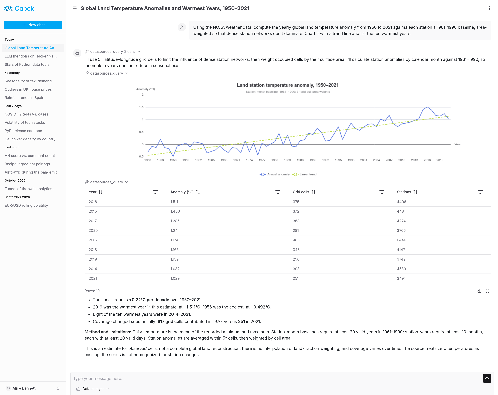

<p align="center">
  
</p>

Capek is a self-hosted conversational AI platform.

> [!WARNING]
>
> This project began as an experiment and remains a work in progress. Breaking changes are expected.

## Features

- Multi-user support with RBAC and row-level security (RLS).
- Single-user, OpenID Connect (OIDC) and proxy authentication modes.
- Agent orchestration with triage and specialist patterns.
- Support for the OpenAI Chat Completions, Open Responses and Anthropic Messages APIs.
- MCP server integration.
- Skills with a sandboxed code interpreter.
- Datasource integration (ClickHouse, MariaDB, PostgreSQL and SQL Server).
- Charts in 2D and 3D (Apache ECharts).
- Sortable and filterable tables with CSV export.
- Dark/Light theme.
- Customizable branding.
- Internationalization.

<figure>
  <picture>
    <source media="(prefers-color-scheme: dark)" srcset="./resources/screenshots/chat-dark.png">
    
  </picture>
  <figcaption><em>Running with gpt-6.1-terra and the ClickHouse Playground.</em></figcaption>
</figure>

## Architecture

The application is composed of [Nuxt layers](https://nuxt.com/docs/guide/going-further/layers), each one providing a
feature. See [`features/`](./features/README.md) for how they work and the documentation of each one.

| Area      | Technology                                  |
| --------- | ------------------------------------------- |
| Framework | Nuxt                                        |
| Frontend  | Nuxt UI, Tailwind CSS, Pinia                |
| API       | tRPC, Zod                                   |
| Database  | PostgreSQL, Kysely (PGlite for development) |
| Testing   | Vitest, Playwright                          |

## Development

### Setup

Use the Node.js and pnpm versions declared in [`package.json`](./package.json).

```sh
pnpm install
pnpm dev
```

The application runs in single-user mode at `http://localhost:3000` and automatically logs in as the admin user.

### Production build

Set `NUXT_ENCRYPTION_KEY` in the server environment before starting. Generate the key with `openssl rand -base64 32` and
keep it across restarts and deployments that use the same database.

```sh
pnpm build
node .output/server/index.mjs
```

Use `pnpm start` to preview the build locally.

### Selecting features

Builds include all features by default, except the [optional ones](./features/README.md#layers). The `FEATURES`
environment variable, or build argument in Docker, selects the ones to include as a comma-separated list, and `core` is
always included. This example builds only the core platform.

```sh
FEATURES=core pnpm build
docker build --build-arg FEATURES=core -t localhost/capek:core ./
```

### Docker

This example runs a disposable container with PGlite.

```sh
docker build -t localhost/capek:latest ./
docker run -it --rm -p 127.0.0.1:3000:3000/tcp -e NUXT_ENCRYPTION_KEY="$(openssl rand -base64 32)" localhost/capek:latest
```

### Docker Compose

These Compose files are for local development only. They contain hardcoded test credentials.

| File                     | Contents                                                    |
| ------------------------ | ----------------------------------------------------------- |
| `compose.base.yaml`      | Base services, such as Traefik and PostgreSQL               |
| `compose.simpleidp.yaml` | Base services with Simple IdP for OIDC                      |
| `compose.keycloak.yaml`  | Base services with Keycloak for OIDC                        |
| `compose.dex.yaml`       | Base services with Dex for OIDC                             |
| `compose.proxy.yaml`     | Base services with proxy authentication for a test identity |

This command starts the full stack with Keycloak.

```sh
docker compose -f ./compose.keycloak.yaml up -d
```

The application is accessible at `https://capek.localhost`.

### Checks

```sh
pnpm run lint
pnpm test:unit
pnpm test:chromium
```

`pnpm run format` applies the fixes that lint can make.

## Configuration

Copy `.env.example` to `.env` and adjust it as needed. These are the main variables.

| Variable                       | Description                                                           | Default                 |
| ------------------------------ | --------------------------------------------------------------------- | ----------------------- |
| `NUXT_DATABASE_URL`            | PostgreSQL connection string or PGlite file path                      | `file://./.data/pglite` |
| `NUXT_AUTH_MODE`               | Authentication mode (`single-user`, `oidc` or `proxy`)                | `single-user`           |
| `NUXT_ENCRYPTION_KEY`          | Encryption key, 32 bytes in base64                                    |                         |
| `NUXT_ENCRYPTION_PREVIOUS_KEY` | Previous encryption key, used while rotating it                       |                         |
| `NUXT_SEED_CONFIG`             | Data to create at startup, as a file path or inline YAML or JSON      |                         |
| `NUXT_ALLOWED_PRIVATE_HOSTS`   | Private hosts that outbound connections can reach (`NO_PROXY` syntax) |                         |
| `NUXT_LOG_LEVEL`               | Log level (`fatal`, `error`, `warn`, `info`, `debug` or `trace`)      | `info`                  |

The [README of each feature](./features/README.md) describes its own configuration, and `.env.example` has examples.

## License

Licensed under the [European Union Public Licence v. 1.2 or later](./LICENSE) ©
[Héctor Molinero Fernández](https://hector.molinero.dev). Review the license conditions before use or distribution.
